<a href="https://keelinfra.io/jenkins/">
  <picture>
    <source media="(prefers-color-scheme: dark)" srcset=".github/readme/hero-dark.svg">
    
  </picture>
</a>

<p align="center">
  <a href="https://github.com/keelinfra/agent8/actions/workflows/ci.yml"></a>
  <a href="https://github.com/keelinfra/agent8/releases/latest"></a>
  <a href="#tested-platforms"></a>
  <a href="#tested-platforms"></a>
  <a href="#license"></a>
</p>

<p align="center">
  <a href="#install"><b>Install</b></a> &nbsp;·&nbsp;
  <a href="#how-it-works"><b>How it works</b></a> &nbsp;·&nbsp;
  <a href="#tested-platforms"><b>Tested platforms</b></a> &nbsp;·&nbsp;
  <a href="docs/install.md"><b>Docs</b></a> &nbsp;·&nbsp;
  <a href="https://keelinfra.io/jenkins/"><b>keelinfra.io</b></a>
</p>

<br>

Current Jenkins needs **Java 21 on every agent**. Build hosts that can't run it, such as AIX 7.1, older HP-UX and Solaris, drop out of the build farm. Agent8 builds an `agent.jar` that runs on **Java 8** (or 11, 17), so those hosts stay ordinary agents of an up-to-date controller: labels, executors, `sh`, file steps, `junit`, `stash`, aborts and the script console work as on any other node.

### Seen this after a controller upgrade?

```text
java.lang.UnsupportedClassVersionError: hudson/remoting/Launcher has been compiled by a more recent version of the Java Runtime (class file version 65.0), this version of the Java Runtime only recognizes class file versions up to 52.0
```

Class file version 65.0 is Java 21 and 52.0 is Java 8; on Java 11 or 17 the message ends in 55.0 or 61.0. If the host can install a newer Java, do that. If it can't, install Agent8 on it.

> [!TIP]
> On RHEL/CentOS 6, try a newer JDK first: Amazon Corretto 21 and Azul Zulu 21 run on CentOS 6.10, and with them the stock `agent.jar` works without agent8. Agent8 is for hosts with no Java 21 build at all, and for hosts whose installed JDK must not change.

## Install

On the build host, with its old Java and the controller's URL:

```sh
curl -fsSLO https://raw.githubusercontent.com/keelinfra/agent8/main/install.sh
sh install.sh --url https://jenkins.example.com/ --replace /path/to/agent.jar
```

`install.sh` picks the agent8 jar that matches the controller and the host's Java, checks its sha256, checks it runs on the host (`--check`), and swaps it in for your `agent.jar` (the old one is kept). Restart the agent with its usual command. Nothing needs to be installed on the controller.

**SSH agents:** install with `--dir /opt/agent8` instead of `--replace`, then set the node's *Java Path* to `/opt/agent8/java`.

After a controller upgrade, rerun `install.sh` so the agent matches the new Jenkins version.

<details>
<summary><b>More:</b> hosts without internet or with an old CA bundle, Ansible for fleets, the versioncolumn plugin, troubleshooting</summary>

<br>

All of it is in [docs/install.md](docs/install.md). Building and testing agent8 itself: [docs/development.md](docs/development.md).

</details>

## How it works

<picture>
  <source media="(prefers-color-scheme: dark)" srcset="docs/how-it-works-dark.svg">
  
</picture>

| | |
|---|---|
| **1 · Ahead of time** | [JvmDowngrader](https://github.com/unimined/JvmDowngrader) rewrites Jenkins' `agent.jar` to Java 8 bytecode. |
| **2 · While builds run** | Classes the controller sends during builds (core and plugin code) are downgraded as they load. |
| **3 · On the wire** | A small Java agent keeps Java serialization compatible with the controller. |

Details: [docs/how-it-works.md](docs/how-it-works.md).

## Tested platforms

Linux is tested in CI on every change and weekly, against the current Jenkins LTS and weekly release. AIX, Solaris and HP-UX have been tested; they are not in CI.

| Agent platform | Tested | Notes |
|---|---|---|
| Linux, HotSpot Java 8 (Temurin), including RHEL/CentOS 6 | **in CI** | on CentOS 6.10 |
| Linux, OpenJ9 Java 8 (IBM Semeru), the JVM family of IBM Java 8 on AIX | **in CI** | best effort (see below) |
| Linux, HotSpot Java 11 (`agent8-java11.jar`) | **in CI** | against the current LTS |
| Linux, HotSpot Java 17 (`agent8-java17.jar`) | **in CI** | against the current LTS |
| AIX 7.1 / 7.2 / 7.3 with IBM Java 8 | tested, not in CI | including aborting builds (child processes are killed) |
| Solaris with Java 8 | tested, not in CI | Oracle Java 8, SSH agent |
| HP-UX with Java 8 | tested, not in CI | Itanium, HP Java 8, SSH agent |

IBM Java and OpenJ9 (J9) are outside Jenkins' own support, so J9 support here is best effort.

**Controllers.** What agent8 has to match is the controller's Jenkins version, not the Java it runs on. CI runs the agent tests against controllers on:

| Controller Java | Jenkins version in CI |
|---|---|
| Java 25 | current LTS |
| Java 21 | current LTS and weekly |
| Java 17 | 2.541.3, the last LTS on Java 17 |
| Java 11 | 2.462.3, the last LTS on Java 11 (bare controller: freestyle build, no plugins) |

Releases are built for the current LTS and weekly, and a weekly check opens an issue when a new Jenkins version has none yet. For an older Jenkins version, [ask for a build](https://github.com/keelinfra/agent8/issues).

## Known gaps

- A newer JDK API that JvmDowngrader cannot stub fails only when that code runs. CI tests Git checkout (JGit and command-line git) and credentials binding. Other plugins that run their own code on agents, such as Docker or artifact repository upload steps (Artifactory, Nexus), are untested. Try those on one host before moving a whole job.
- The Maven project type (maven-plugin) does not work: it starts its own JVM for Maven, which agent8 does not reach. Run Maven from a Pipeline or freestyle shell step (`sh 'mvn ...'`) instead; that works like any other command.

## Get involved

A test report from a platform that isn't in CI, or a plugin that breaks on an old agent, is the most useful thing you can send: [open an issue](https://github.com/keelinfra/agent8/issues). Pull requests are welcome; [docs/development.md](docs/development.md) says how to build and test.

> [!NOTE]
> Agent8 is an independent project. It is not part of, or endorsed or supported by, the Jenkins project. Please report problems [here](https://github.com/keelinfra/agent8/issues), not to the Jenkins issue tracker.

Using GitLab CI on AIX 7.2 or 7.3? See [aix-runner](https://github.com/keelinfra/aix-runner) (unofficial GitLab Runner builds).

## License

[MIT](LICENSE). The jars also bundle Jenkins remoting (MIT), ASM (BSD-3-Clause) and parts of JvmDowngrader (LGPL-2.1); `jvmdg.jar` is JvmDowngrader itself, unmodified. Details in [docs/license.md](docs/license.md).

<br>

<p align="center">
  <a href="https://keelinfra.io"></a>
  <br>
  <sub>
    Part of <a href="https://keelinfra.io"><b>keelinfra</b></a>: tested, open-source builds for CI that can't upgrade yet.<br>
    <a href="https://github.com/keelinfra/jenkins-extended-security">Extended Security for Jenkins 2.541.x</a> &nbsp;·&nbsp;
    <a href="https://keelinfra.io/jenkins/upgrade-matrix/">Jenkins upgrade matrix</a> &nbsp;·&nbsp;
    <a href="https://github.com/keelinfra/aix-runner">AIX Runner for GitLab</a>
  </sub>
</p>
