<a href="https://keelinfra.io">
  <picture>
    <source media="(prefers-color-scheme: dark)"
            srcset="https://raw.githubusercontent.com/keelinfra/.github/main/assets/wordmark-dark.svg">
    
  </picture>
</a>

# Agent8 for Jenkins

[](https://github.com/keelinfra/agent8/actions/workflows/ci.yml)
[](https://github.com/keelinfra/agent8/releases)
[](#install)
[](#license)

Run a **native Jenkins agent on Java 8**, connected to a current Jenkins controller that runs on Java 21 or newer.

> Agent8 is an independent project. It is not part of, or endorsed or supported by, the Jenkins project. Please report problems [here](https://github.com/keelinfra/agent8/issues), not to the Jenkins issue tracker.

Jenkins requires Java 21+ on the controller and on every agent. Build hosts that cannot run Java 21 — AIX 7.1, older HP-UX and Solaris — are left behind, and their teams stay on old, unsupported Jenkins. This project builds an `agent.jar` that runs on Java 8, so these hosts stay ordinary agents: labels, executors, `sh`, file steps, `junit`, `stash`, aborts and the script console work as on any other node.

On RHEL/CentOS 6 x86_64, try a newer JDK first. The OS repositories stop at OpenJDK 8, but Amazon Corretto 21 and Azul Zulu 21 run on CentOS 6.10, and with them the stock `agent.jar` connects to the current LTS and runs builds without agent8 (checked in GitHub Actions, 2026-10-15). Eclipse Temurin 21 does not start there (it needs glibc 2.14; CentOS 6 has 2.12), Java 17 is too old for current Jenkins agents, and Corretto 25 needs RHEL 7+, so this route ends when Jenkins requires Java 25. Agent8 is for hosts with no Java 21 build at all, and for hosts whose installed JDK must not change, such as a certified or validated toolchain.

<picture>
  <source media="(prefers-color-scheme: dark)" srcset="docs/how-it-works-dark.svg">
  
</picture>

## Status

Available and free to use (MIT). Linux is tested in CI on every change, and weekly, against the current Jenkins LTS and weekly release. agent8 has also been tested on AIX, Solaris and HP-UX; those platforms are not in CI.

| Agent platform | Status |
|---|---|
| Linux, HotSpot Java 8 (Temurin), including RHEL/CentOS 6 | Tested in CI on CentOS 6.10 |
| Linux, OpenJ9 Java 8 (IBM Semeru) — the JVM family of IBM Java 8 on AIX | Tested in CI; best effort (see below) |
| AIX 7.1 / 7.2 with IBM Java 8 | Tested; not in CI |
| Solaris with Java 8 | Tested (Oracle Java 8, SSH agent); not in CI |
| HP-UX with Java 8 | Tested (Itanium, HP Java 8, SSH agent); not in CI |
| Linux, HotSpot Java 11 (`agent8-java11.jar`) | Tested in CI against the current LTS |
| Linux, HotSpot Java 17 (`agent8-java17.jar`) | Tested in CI against the current LTS |

**OpenJ9 and IBM Java (J9) are outside Jenkins' own support:** the Jenkins Platform SIG [stopped supporting OpenJ9](https://github.com/jenkinsci/remoting/issues/1223#issuecomment-3577915365) in 2021, and the Jenkins issue tracker has a history of J9-specific problems. On AIX, IBM Java 8 is often the only Java there is, so agent8 tests OpenJ9 8 in CI and fixes J9-specific failures it finds (two so far, both in JvmDowngrader), but support for J9 is best effort. Please report J9 problems [here](https://github.com/keelinfra/agent8/issues), not to Jenkins.

Java 8 is the main target. The same build also makes jars for hosts capped at Java 11 (Solaris SPARC and x86 stop at JDK 11, since JDK 15 dropped those ports) and Java 17.

## Install

On the build host, with its old Java (8, 11 or 17), and the controller's URL:

```sh
curl -fsSLO https://raw.githubusercontent.com/keelinfra/agent8/main/install.sh
sh install.sh --url https://jenkins.example.com/ --replace /path/to/agent.jar
```

If that `curl` fails with `SSL certificate problem: unable to get local issuer certificate`, the host's CA bundle is too old to verify GitHub, which is common on old hosts. Do not turn verification off (`-k`). Download `install.sh` on a current machine and copy it over (`scp install.sh host:`), or point curl at a current bundle, for example one copied from a current machine (`curl --cacert cacert.pem ...`; `install.sh --cacert FILE` passes it on). `install.sh` itself falls back to Java's own trust store when curl or wget cannot verify a download. If that fails too, or the host has no internet access, download the release files elsewhere and use `--from DIR` (below).

`install.sh` asks the controller for its remoting version, downloads the matching agent8 jar for the host's Java (`agent8-java8.jar`, `agent8-java11.jar` or `agent8-java17.jar`) and `jvmdg.jar` from this repository's releases, checks them against the release's `sha256sums.txt` (with `sha256sum`, `shasum`, `digest` or `openssl`, or with Java when the host has none of these), checks that they start with the host's Java and can use its security providers, key store and TLS (`java -jar agent8.jar --check`, which you can also run yourself), and swaps them in for the `agent.jar` the host runs today (the old jar is kept as `agent.jar.before-agent8`). Restart the agent with its usual command, for example:

```sh
java -jar /path/to/agent.jar -url https://jenkins.example.com/ -secret <secret> -name <node> -workDir /srv/jenkins
```

Releases are named after the Jenkins version: `jenkins-2.580.1` is agent8 for Jenkins 2.580.1 (your version is at the bottom right of every Jenkins page). What has to match underneath is the agent's remoting version, and several Jenkins versions can ship the same one, so a release also works with every other Jenkins version that ships its remoting version; the release notes name it. You rarely need to pick by hand: `install.sh --url` asks the controller for its remoting version and finds the matching release through `index.txt` on the latest release (one line per release: remoting version, tag).

Nothing else changes: the agent8 jar starts the Java agents it needs itself. With `--replace` it writes only next to the old jar, so it runs as the agent's own user; without it, it installs to `/opt/agent8` (`--dir`). Hosts without internet access: download the agent8 jars, `jvmdg.jar` and `sha256sums.txt` from the [releases](https://github.com/keelinfra/agent8/releases) and pass `--from DIR`. `--target 8|11|17` (Ansible: `agent8_target`) picks a build instead of going by the host's Java. `sh install.sh --help` lists all options.

For many hosts, the Ansible playbook runs the same script and needs no Python on the hosts:

```sh
ansible-playbook -i inventory ansible/agent8.yml \
  -e agent8_controller_url=https://jenkins.example.com/ \
  -e agent8_replace=/opt/jenkins/agent.jar \
  -e "agent8_restart='/etc/init.d/jenkins-agent restart'"
```

For SSH agents pass `-e agent8_dir=/opt/agent8` instead of `agent8_replace` and set each node's *Java Path* to `/opt/agent8/java` (see SSH agents below); Jenkins relaunches them, so no restart command is needed. The other options map one to one: `agent8_version`, `agent8_from`, `agent8_cacert`, `agent8_repo`, `agent8_java`, `agent8_target`, and `agent8_restore` to undo a swap.

**Controller setting, if the Versions Node Monitors plugin (`versioncolumn`) is installed.** Its *JVM Version* monitor takes every agent whose Java is older than the controller's offline, seconds after it connects ("incompatible JVM version between agent and controller"). For agent8 hosts, set it to not disconnect under *Manage Jenkins → Nodes → Configure Node Monitors*, or in configuration as code:

```yaml
jenkins:
  nodeMonitors:
    - jvmVersion:
        ignored: true
```

Its *Remoting Version* monitor also takes agents offline whose remoting version differs from the controller's. `install.sh` installs the matching build when a release exists for the controller's remoting version; when it falls back to the latest build ("no agent8 build for remoting … yet"), ignore that monitor too, or ask for a build for that version.

**Upgrading the controller.** It works as with the stock agent: the controller's restart drops all agents, Pipeline builds resume once their agent is back, and freestyle builds that were running are aborted. The agents reconnect on their own, still with the agent8 jar built for the old controller. Without the versioncolumn plugin that keeps working: CI runs the latest release against the newer weekly controller (remoting 3386 against 3391) through the full test, Pipeline, Git, credentials, abort and restart included. With versioncolumn, its *Remoting Version* monitor takes those agents offline until they match, unless it is set not to disconnect. This only stretches so far: Jenkins refuses agents older than a minimum remoting version that it raises over time, and Jenkins 2.586 already refuses the agent8 build for Jenkins 2.462.3 ("Agent version 3256.3258.v858f3c9a_f69d or newer is required"), so an agent8 jar cannot be pinned through all future controller upgrades. Either way, rerun `install.sh` (or the Ansible playbook) after the upgrade and restart the agent, so it matches the controller again. When a new Jenkins LTS or weekly ships a remoting version that has no agent8 release yet, a weekly workflow opens an issue here.

**The old jar.** On the first `--replace`, the host's original jar is renamed to `agent.jar.before-agent8` (a later run never overwrites it), and agent8 is moved into place under the original name, so a running agent keeps its open file. `sh install.sh --restore /path/to/agent.jar` puts the original back and removes `jvmdg.jar`. Keep the backup until the agent has run builds for a while, then delete it.

`install.sh` sticks to POSIX `sh` commands (no `command -v`, `!`, `tail -n`, `head -n`, `mktemp -d` or GNU-only flags), reruns itself under a POSIX shell (`/usr/xpg4/bin/sh`, else `ksh`) on Solaris 10's Bourne shell, and is checked with `shellcheck -s sh`. CI runs it on CentOS 6 and Ubuntu, and it has been tested on AIX, Solaris and HP-UX. Windows hosts can run a current Java and the stock `agent.jar`, so agent8 does not target them.

The agent host needs a `kill` command on the `PATH`, which every real RHEL 6 and AIX system has.

**SSH agents (SSH Build Agents plugin).** That plugin copies the controller's stock `remoting.jar` to the agent's directory and runs `java -jar remoting.jar` on every launch, so replacing a jar on the host does not last. Install without `--replace`, then set one field on the node:

```sh
sh install.sh --url https://jenkins.example.com/ --dir /opt/agent8
```

*Manage Jenkins → Nodes → the node → Configure → Launch method → Advanced → Java Path*: `/opt/agent8/java`. This is the file `install.sh` wrote, not the host's own `java` (not `/usr/bin/java`, and not empty). The launch log shows which one ran: `Starting agent process: cd "..." && /opt/agent8/java -jar remoting.jar` is right. That file, written by `install.sh`, runs the host's Java with `/opt/agent8/agent8.jar` where the plugin asks for `remoting.jar`, and passes everything else through. No *Prefix Start Agent Command* is needed, and the node's other settings (JVM options, remote root directory, credentials) stay as they are. CI tests this with the SSH Build Agents plugin on HotSpot 8 and OpenJ9 8.

**A host that already serves another controller** (for example while moving jobs from an old controller to a new one): install with its own `--dir` and give the new node its own remote root directory (`-workDir`), so the two agents share nothing. Do not `--replace` the jar the other agent runs, and never the `remoting.jar` an SSH launcher copies (`install.sh` warns about that name).

### Troubleshooting

| You see | Cause and fix |
|---|---|
| `curl: (60) SSL certificate problem` when fetching `install.sh` | The host's CA bundle is too old. Copy `install.sh` from a current machine or use `curl --cacert FILE`; never `-k`. |
| `UnsupportedClassVersionError ... class file version 55.0` (or 61, 65) on an SSH node | The host's own Java ran the stock `remoting.jar`: the launch log shows `&& java -jar remoting.jar` or `&& /usr/bin/java -jar remoting.jar`. Set the node's *Java Path* to `DIR/java`, the file `install.sh` wrote (above). |
| `ERROR: Already connected`, then "Launch failed" | A second launch of the same node started while the first was still coming up, and the first one won; the node is usually online. The first start on a slow host takes a minute or more while JvmDowngrader prepares its own jar ("this may take a minute"); later starts are fast. Click *Launch agent* once and wait. |
| `Failed to monitor for Free Swap Space`, `No suitable implementation found: os.name=HP-UX` | Jenkins' swap monitor has no HP-UX implementation; the stock agent shows the same. Harmless: only that column stays empty. |
| `signer information does not match` / `Signers of ... do not match`, `jks not found` | A signed security provider (IBMJCE on IBM Java, SunPKCS11 on Solaris) broken by JvmDowngrader. Fixed since [#9](https://github.com/keelinfra/agent8/pull/9); rerun `install.sh` to get a release with the fix. |
| The node goes offline seconds after connecting, "incompatible JVM version" | The versioncolumn plugin's JVM Version monitor; set it not to disconnect (above). |
| `Agent version ... or newer is required` | The controller was upgraded past this build; rerun `install.sh`. |

`java -jar agent8.jar --check` prints what works and what does not on a host, without connecting to anything; please include its output, `java -version` and the OS version (`oslevel -s`, `uname -a`) when you [report a problem](https://github.com/keelinfra/agent8/issues).

### Build it yourself

```sh
curl -fsSO https://jenkins.example.com/jnlpJars/agent.jar
./build.sh agent.jar          # needs JDK 17+, git, curl, unzip, python3; writes dist/agent8-java8.jar
./build.sh agent.jar 8 11 17  # also dist/agent8-java11.jar and dist/agent8-java17.jar
```

## How it works

Jenkins agents run two kinds of Java code: remoting itself (`agent.jar`), and classes the controller sends while builds run — core and plugin code for `FilePath`, `junit`, `stash`, launching processes and so on. Both are compiled for Java 17 or 21.

1. **remoting is downgraded ahead of time.** [JvmDowngrader](https://github.com/unimined/JvmDowngrader) rewrites `agent.jar` to Java 8 bytecode (or 11 or 17) and adds stand-ins for newer JDK APIs. One call it cannot handle is patched in the remoting source (`patches/`; older remoting versions do not need it).
2. **Classes from the controller are downgraded as they load**, by JvmDowngrader's Java agent (`jvmdg.jar`).
3. **The agent8 jar is a drop-in for `agent.jar`.** When started with plain `java -jar`, it starts the same Java again with both Java agents and the same JVM options.
4. **It is also a Java agent** that keeps Java serialization compatible with the controller:
   - Downgrading adds synthetic members, which changes the default `serialVersionUID` of classes that do not declare one. The controller would then reject every call. The agent pins the UID the controller computes, before downgrading. Records get UID 0.
   - It adds `java.util.CollSer`, the serial form of `List.of`, `Set.of`, `Map.of` and `Stream.toList()`, which Java 8 does not have. On Java 9 to 15 it teaches the JDK's own `CollSer` the form `Stream.toList()` uses since Java 16.
   - On OpenJ9 it adds a stand-in for HotSpot's internal `ClassLoader$ParallelLoaders`, which JvmDowngrader's `ClassLoader` stubs need.
   - It fixes JvmDowngrader stubs that behave differently from the JDK: `InputStream.readNBytes(int)` allocated the full length up front, so `readNBytes(Integer.MAX_VALUE)`, which JGit uses to read Git config files, failed on Java 8.
   - It keeps signed jars working. JvmDowngrader drops the signers of every class loaded after it starts, so a signed jar that was already in use before that fails with "signer information does not match". Security providers are such jars: SunPKCS11 / OracleUcrypto on Solaris (the first TLS or digest call failed), and IBMJCE on IBM Java, the only provider of the `JKS` key store there (remoting could not build its TLS context, so the agent never connected). agent8 and the classes the controller sends are not signed, so agent8 turns that part of JvmDowngrader off.

## Tests

- `test/serialization.sh`: objects written on Java 21 are read on Java 8.
- `test/it.sh`: installs agent8 with `install.sh` over a stock `agent.jar` in a container with old Java (CentOS 6 with HotSpot 8, Ubuntu with OpenJ9 8, Ubuntu with HotSpot 11 and 17), starts it with the usual command against a running controller and checks Pipeline builds, a Git checkout (JGit, i.e. plugin code from the controller running on old Java), `withCredentials`, abort, agent restart during a build, the script console, and `--replace`/`--restore`. With `BASIC=1` it runs against a bare controller (core only, freestyle shell build), for older Jenkins lines whose plugins no longer install.

- `test/ssh.sh`: an SSH Build Agents node with *Java Path* set to the file `install.sh` writes, on a HotSpot 8 and an OpenJ9 8 host whose first security provider is a signed jar (as on Solaris and IBM Java); checks `--check`, that the node comes online, the script console, the signed provider, and a freestyle build.

CI runs these weekly against the latest LTS and weekly Jenkins (`test/ssh.sh` against the LTS).

## Releasing

Run the **Release** workflow (Actions → Release → Run workflow). By default it builds and tests the current Jenkins LTS and weekly, then publishes one release per Jenkins version (tag `jenkins-<version>`) with all three jars, a CycloneDX SBOM per jar, `sha256sums.txt` and signed attestations (see [SECURITY.md](SECURITY.md#checking-a-release)), and refreshes `index.txt` on the latest release; list other Jenkins image tags to release older versions, or tick *dry run* to build and test only. Older Jenkins lines whose plugins no longer install (for example `2.462.3-lts-jdk17`) go in the *basic* field: they are tested against a bare controller with a freestyle shell build, and their release notes say so. CI itself does not publish; a weekly *Remoting check* workflow opens an issue when the current LTS or weekly ships a remoting version that has no release yet.

## Known gaps

- A newer JDK API that JvmDowngrader cannot stub fails only when that code runs. Plugins that run their own code on agents beyond Git checkout (JGit) and credentials binding, which CI tests, such as Maven, Docker, artifact repository upload steps (Artifactory, Nexus) or command-line git, still need testing. Try those on one host before moving a whole job.
- On AIX, Jenkins code on the agent loads JNA (for example to kill a build's processes on abort); see [#2](https://github.com/keelinfra/agent8/issues/2). The Maven project type (maven-plugin), which starts its own remoting JVM, is untested.

## License

[MIT](LICENSE) for this project's own code. The agent8 jars also contain:

- Jenkins remoting (MIT), downgraded and with one patched class;
- ASM (BSD-3-Clause);
- classes from [JvmDowngrader](https://github.com/unimined/JvmDowngrader) (LGPL-2.1), shaded into the jar by `build.sh`: the stand-ins for newer JDK APIs that the downgraded remoting calls. They are unmodified apart from the package rename (at run time agent8 replaces one stub method, `InputStream.readNBytes(int)`, see `src/io/keelinfra/agent8/StubFixes.java`); their source is in the JvmDowngrader repository at the version `build.sh` pins (2.0.1), and `build.sh` rebuilds the jars from it, so you can swap in your own build of JvmDowngrader.

`jvmdg.jar` is JvmDowngrader 2.0.1 itself, distributed unmodified under the [LGPL-2.1](https://github.com/unimined/JvmDowngrader/blob/main/LICENSE.md).

## Commercial support

Agent8 is free and stays MIT. For a pilot on AIX, Solaris or HP-UX, a plugin compatibility check, or yearly support that keeps up with controller upgrades, see [keelinfra.io/jenkins/pricing](https://keelinfra.io/jenkins/pricing/).
